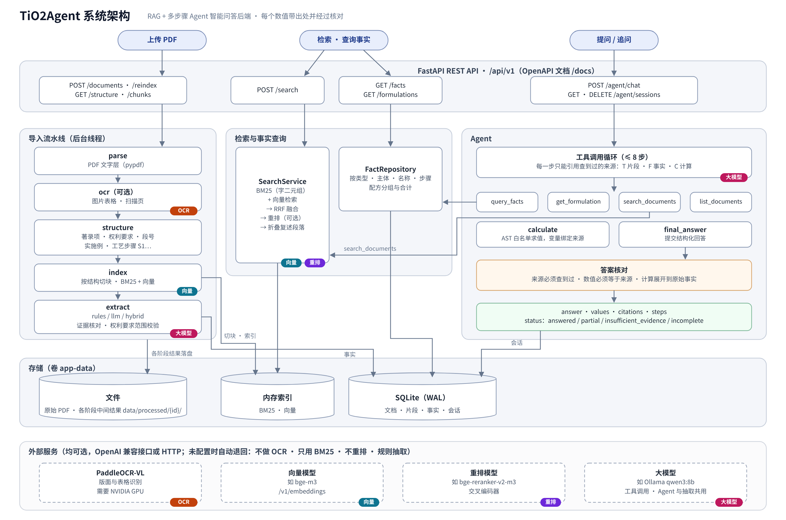

# TiO2Agent
面向钛白粉（TiO₂）技术文档的**RAG + 多步骤 Agent 智能问答后端**。

后端采用 FastAPI 实现，支持容器化一键部署运行，大模型（Ollama 或任何 OpenAI 兼容接口）和 OCR（PaddleOCR-VL）为可选组件。

导入 PDF 格式的专利后，可以检索原文、查询结构化的配方与工艺参数，并由 Agent 规划多步查询和计算，然后生成回答，每个数值都带出处、并经过核对。

- **后端：** FastAPI REST API。
- **部署：** Docker Compose 一条命令启动；大模型（Ollama 或任何 OpenAI 兼容接口）和 OCR（PaddleOCR-VL）为可选组件。

## 项目结构

```text
src/tio2agent/
  main.py              create_app()、启动入口
  config.py            全部配置（环境变量前缀为 TIO2_）
  domain/              领域模型：文档、结构、片段、事实、回答等
  ingestion/
    pipeline.py        流水线；runner.py / service.py 后台执行与上传
    stages/            各阶段：parse · ocr · structure · index · extract
    ocr/               PaddleOCR-VL 客户端、表格 HTML 解析
    structure/         专利扉页、权利要求、说明书、实施例识别；通用文档
    extraction/        规则抽取、大模型抽取与核对、二者合并、数量与单位、范围校验
  retrieval/           分词、BM25、向量、RRF 融合、重排
  storage/             SQLite 仓储（文档、片段、事实）、文件存储
  llm/                 OpenAI 兼容的工具调用客户端（Agent 与抽取共用）
  agent/               工具、来源账本、计算器、循环、答案核对、会话
  api/                 路由、schema、错误处理、中间件
evals/                 检索、抽取、Agent 评测脚本与数据集；抽取标准答案
scripts/               check_offline.py（离线流水线检查）、OCR 表格评测
tests/                 单元测试与集成测试（含大模型、向量、OCR 的替身）
```

## 系统架构

<div align="center">
  
</div>

- [OCR](docs/ocr.md)
- [切块与检索](docs/retrieval.md)
- [结构化抽取](docs/extraction.md)（规则、大模型、合并）
- [Agent](docs/agent.md)
- [部署](docs/deployment.md)

数据处理流程：

1. **导入**：原文档（如：一种高耐候钛白粉及制备方法.pdf）保存在 `data/samples/` 目录下，上传后先返回 `202`，再在后台依次执行后续阶段。每个阶段的中间结果都保存在 `data/processed/{id}/` 下，可以单独查看和重跑。
   - OCR 失败只记为警告，文字层的内容依然可用。
2. **结构识别**：把专利拆成扉页著录项、摘要、权利要求（区分产品和方法）、说明书段落（保留原文段号 `[0026]`）、实施例和对比例，并标出工艺步骤 `S1`、`S2`……
   - 后续的切块、抽取和引用都基于这个结构，每个答案都能指回具体的权利要求或段落。
3. **检索**：
   - 切块按文档结构进行：每条权利要求一块、每个实施例一块。
   - BM25 与向量检索的结果用 RRF 融合，可选交叉编码器重排。
   - 只复述权利要求的说明书段落会和对应的权利要求折叠成一条结果。
4. **事实库**：从权利要求和实施例中抽取四类事实：组分、工艺参数、可选材料、检测结果。
   - 抽取方式三选一：规则、大模型，或二者合并（`TIO2_EXTRACT_BACKEND=rules / llm / hybrid`）。
   - 每条事实必须附带原文证据，证据是原文的精确子串，否则丢弃。
   - 实施例中的数值会与权利要求的范围对照校验。
5. **Agent**：大模型通过工具调用查事实、检索原文、做计算，最后用 `final_answer` 提交结构化回答。系统会逐项核对：
   - 引用的来源必须在本轮查到过；
   - 数值必须等于来源中的值；
   - 计算只能使用来源里的数，并会展开到它用到的原始事实。

## 技术选型

| 方面 | 选择 | 说明 |
|---|---|---|
| 语言与项目管理 | Python 3.11，uv，src 布局 | `uv.lock` 锁定全部依赖，本地与镜像一致 |
| Web 框架 | FastAPI + Pydantic | 请求和响应都有类型化的 schema，自动生成 OpenAPI 文档；错误统一为 `{"error": {code, message, details}}` |
| PDF 解析 | pypdf 文字层优先 | 证据核对和引用要求文字层与原文完全一致；文字层缺失的部分（如：表格、流程图）通过 OCR 识别 |
| OCR | PaddleOCR-VL 流水线（可选） | 默认关闭，开启时需要另起一个 PaddleOCR-VL 服务，该服务需要 NVIDIA GPU |
| 结构识别 | 针对专利格式的规则 | 结果确定、可解释，保留原文段号；每条格式规则都注明是在哪篇样本中出现的，不支持没有出处的写法 |
| 存储 | SQLite（WAL）+ 文件 | 未来可拓展为外部知识库 |
| 关键词检索 | 采用 BM25，中文按 bigram 切分 | 能可靠地处理数据中大量的术语 |
| 向量检索 | 任何 OpenAI 兼容 `/v1/embeddings`（如 bge-m3），numpy 内存索引（可选） | 未配置或出错时自动退回 BM25 |
| 融合与重排 | RRF（k=60）+ 可选交叉编码器（如 bge-reranker-v2-m3） | 重排只对前 30 个候选打分，控制延迟 |
| 结构化抽取 | 规则抽取 + 证据核对 + 权利要求范围校验 | 计算需要准确的数字，不能从文本片段里临时读取；错抽会被证据核对和范围校验拦截 |
| 大模型抽取（可选） | 每条权利要求、每个实施例各抽一次，工具调用提交；每条事实逐项核对；可与规则抽取结果合并 | 弥补规则的泛化能力；大模型只决定名称和数值，主体、位置、步骤以文档结构为准，幻觉产生的数字和证据进不了 SQLite 事实库。默认关闭思考模式（只是照原文摘录，思考反而会超时），超时不重试，连续失败两次就停用，退回规则 |
| 大模型 | 任何支持工具调用的 OpenAI 兼容接口；默认本地 Ollama `qwen3:8b` | 可以完全离线运行，数据不出本机；换托管模型只需改配置 |
| Agent | 自定义的工具调用循环 | 包括 `ListDocumentsTool`，`SearchDocumentsTool`，`QueryFactsTool`，`GetFormulationTool`，`CalculateTool` |
| 计算 | AST 白名单求值，不调用 `eval` | 变量必须绑定来源编号 |
| 部署 | Docker 镜像 + Compose 叠加文件 | API 单独一个镜像；Ollama、GPU、OCR 按需叠加 |

## 使用指南

### Docker 部署

```bash
# 打开一个终端
OLLAMA_CONTEXT_LENGTH=16384 ollama serve

# 另开一个终端
ollama pull qwen3:8b  # 下载大模型到本地
docker compose up -d --build

# 离线流水线检查作业提供的 4 篇专利文档
uv run python scripts/check_offline.py --base-url http://localhost:8000 --reindex --out evals/reports/offline-hybrid.json
```

注：测试时使用的机器是Mac，不支持Nvidia GPU。如果机器支持Nvidia GPU，可加上：

```bash
docker compose -f compose.yaml -f compose.ollama.yaml up -d --build
docker compose -f compose.yaml -f compose.ollama.yaml -f compose.ollama-gpu.yaml up -d --build
```

### 本地运行

```bash
uv sync
uv run tio2agent                      # http://localhost:8000/docs
```

用例：
```bash
curl -F "file=@data/samples/一种高耐候钛白粉及制备方法.pdf;type=application/pdf" \
     http://localhost:8000/api/v1/documents

curl -X POST localhost:8000/api/v1/search -H 'content-type: application/json' \
     -d '{"query": "加入锆盐后pH值调节到多少", "top_k": 5}'

curl 'localhost:8000/api/v1/facts?kind=parameter&name=pH&step=S3'

curl -X POST localhost:8000/api/v1/agent/chat -H 'content-type: application/json' \
     -d '{"question": "实施例1的原料配方合计多少份？"}'
```

### 测试
共 320 个测试，包括解析、结构识别、切块、检索、抽取、OCR 客户端、大模型客户端、Agent 循环与核对、计算器和全部 API。

```bash
uv run pytest
```

## 免责声明

本项目的成品及其所有代码为针对面试应聘作业开发，并非针对商业用途开发，开发者（本人）对本项目的成品及其代码用于商业用途所造成的一切后果及损失不承担任何责任。
